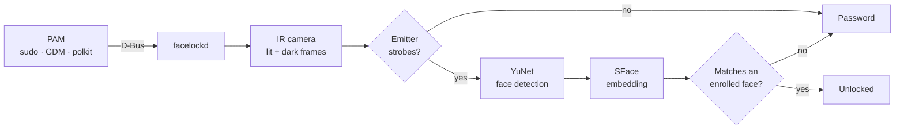

<div align="center">


# NovID

**Infrared face authentication for Linux.**<br>
Unlock `sudo`, the GDM login and lock screen, and polkit prompts with your face,
and optionally your GNOME keyring too.


[Install](#install) · [How it works](#how-it-works) · [Usage](#usage) · [Configuration](#configuration) · [Security](#security-notes)

</div>

---

## Features

| | |
| --- | --- |
| 🔦 **IR liveness** | Works with Windows Hello–style infrared cameras. The IR emitter must strobe and light your face, so photos and screens are refused. |
| 🔑 **Never locks you out** | When the face path is unavailable (no camera, lid closed, SSH session, daemon down), PAM falls back to your password. |
| 🔐 **Keyring unlock** *(opt-in)* | Your login password is sealed with the TPM (`systemd-creds`) and handed to `pam_gnome_keyring` only after a face match at GDM login. |
| 🖥️ **GTK app** | Guided enrollment, a live recognition test, and one switch per place the face is used. |
| 👓 **Several profiles** | Enroll yourself with and without glasses; any profile can unlock. |
| 🧩 **Clean PAM edits** | Only marked lines are added to `/etc/pam.d`, and they are removed before uninstalling. |

## How it works



The daemon runs as a sandboxed systemd service, starts on demand through
D-Bus, and can only reach the camera, the TPM, its own state and the files it
manages (`/etc/pam.d`, `/etc/facelock`).
Changing a setting goes through polkit and asks for an admin password.

## Install

> **Requirements:** an infrared camera, systemd, and Arch Linux, Debian 13 or
> Ubuntu 25.04 (or a derivative). A TPM2 is needed only for the keyring option.

### Debian / Ubuntu

Download `facelock_*.deb` and `facelock-gtk_*.deb` from the
[latest release](https://github.com/Radinux/novid/releases/latest), then:

```sh
sudo apt install ./facelock_*.deb ./facelock-gtk_*.deb
```

The packages bundle ONNX Runtime (in `/usr/lib/facelock`) and the models.

### Arch Linux, or from source

```sh
git clone https://github.com/Radinux/novid.git
cd novid
./install.sh
```

Run it as your normal user; it asks for sudo when needed.

- **Arch** and derivatives: builds the `facelock` and `facelock-gtk` packages
  with `makepkg` and installs them with `pacman`.
- **Debian / Ubuntu**: installs the build dependencies, plus Rust through
  rustup if the packaged version is too old, then builds the `.deb` packages
  (`dist/debian/build-deb.sh`) and installs them with `apt`.

The ONNX models (YuNet, SFace) are downloaded from
[OpenCV Zoo](https://github.com/opencv/opencv_zoo) and checked by SHA-256.

> [!NOTE]
> Installing doesn't turn face authentication on anywhere. Open **NovID** to
> add your face, then choose where to use it.

### Uninstall

```sh
./install.sh --uninstall          # keeps enrolled faces and the config
./install.sh --uninstall --purge  # also deletes them
```

facelock is removed from `/etc/pam.d` first, so no PAM stack is left pointing
to a missing module. `pacman -R facelock` and `apt remove facelock` do the
same, and `apt purge` also deletes the enrolled faces.

## Usage

**In the app:** open **NovID**, add your face (a short guided head turn), try
it with the live test, then turn on the places where you want it: sudo, the
login screen, polkit and the keyring.

**From a terminal:**

```sh
facelock enroll --label "Glasses"   # add a face
facelock list                       # enrolled faces
facelock verify                     # try it, as PAM would
facelock rename <id> "New label"
facelock remove <id>
```

## Configuration

All the settings live in `/etc/facelock/config.toml`. Every key is optional,
and [`dist/config.toml`](dist/config.toml) lists the defaults. The ones you are
most likely to change:

```toml
[camera]
device = "auto"      # or a stable path from /dev/v4l/by-path/
allow_rgb = false    # fall back to a regular webcam (much weaker)

[verify]
threshold = 0.5      # higher = stricter match
fast_threshold = 0.8 # two frames this similar are enough (faster unlock)
timeout_ms = 4000
max_failures = 5     # then wait cooldown_s seconds
cooldown_s = 30
```

## Security notes

> [!WARNING]
> Face recognition is weaker than a good password against someone who looks
> very much like you (a twin or a close sibling). Raise `threshold` to trade
> convenience for margin.

- With the keyring option, root on the running machine can unseal your login
  password. The sealed file is useless on another machine or boot chain.
- Regular (RGB) webcams are refused unless you allow them; they offer no
  liveness check and never unlock the keyring.

## Project layout

The packages, commands and services keep the technical name `facelock`.

| Path | What it is |
| --- | --- |
| `crates/facelock-core` | Camera capture, YuNet face detection, SFace embeddings, head pose, IR liveness, enrollment and verification |
| `crates/facelockd` | System D-Bus service (polkit-guarded); manages the PAM files and the sealed keyring secret |
| `crates/pam-facelock` | `pam_facelock.so` |
| `crates/facelock-cli` | `facelock` command-line client |
| `gtk/` | `facelock-gtk`, the GTK4 / libadwaita app (Python) |
| `dist/` | systemd, D-Bus and polkit files, default config, Arch PKGBUILD, Debian package build |

## License

GPL-3.0-or-later. The ONNX models keep their own licenses: YuNet is MIT,
SFace is Apache-2.0.
